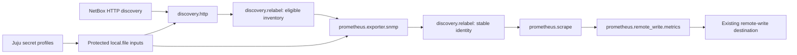

# Alloy network monitoring architecture

The charm orchestrates configuration, Juju secrets, service control and existing
integrations. Alloy performs continuous inventory discovery, SNMP collection and
forwarding. There is no hook-time inventory client or inventory writer.

[network_monitoring.py](../src/network_monitoring.py) validates public settings
and named SNMPv3 profiles and renders the network component graph.
[secret_files.py](../src/secret_files.py) stages root-owned credential generations.
[charm.py](../src/charm.py) resolves granted secret revisions and applies a
validated generation, restoring previous files and service settings on failure.
Applied state advances after service application succeeds.
[alloy.py](../src/alloy.py) controls the service and atomically writes protected
files. [config_builder.py](../src/config_builder.py) composes the graph with
existing telemetry sources and destinations.

All relation definitions and vendored libraries retain their previous contracts.
Machine-observability inputs preserve each provider's source topology. Related
and manual metrics use the shared existing writer; logs use existing Loki
outputs. Device samples use stable NetBox identity and collector scope without
borrowing collector Juju ownership. Local host and Alloy self metrics retain
collector Juju topology.

The existing v3 rule pipeline continues to validate, cache and forward owned
Prometheus/Loki artifacts. [network_alerts.py](../src/network_alerts.py) adds
collector-scoped Prometheus groups through the same bounded `alert_rules` payload
and encoding negotiation. It adds no relation fields. Dashboards still pass
directly from their providers to Grafana.

The writer name and package storage configuration remain stable. Charm refresh
skips workload installation, rewriting and restarting in `upgrade-charm`.
Discovery changes happen in Alloy without charm events or restarts. Missing
destinations disable network collection; a configured destination outage uses
the bounded remote-write WAL. See the [operator guide](network-monitoring.md) for
filters, profiles, labels and failure behavior.
